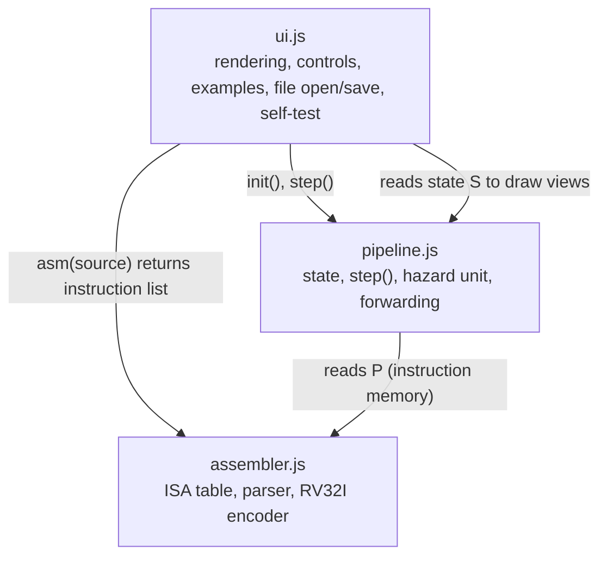

# LIMO Pipeline Simulator: Design Document

**CS3520 · Team 7 · Milestone M2 (simulator design)**
This document describes the design of the browser-based simulator (Deliverable B). The instruction set itself is specified separately in `isa-specification`.

## 1. Goals and constraints

| Goal | Design response |
|---|---|
| Runs wholly in the browser, no server, under 2 MB | Static HTML, CSS and JavaScript, no dependencies, published on GitHub Pages |
| A first-year student can see what each stage does each cycle | One cycle per Step, per-stage live values, narration in English and Sesotho |
| Hazards are visible, and their cost can be measured | Hazard log, pipeline chart, stall and flush counters, Forwarding ON/OFF switch |
| Every decision can be defended orally | Small modules, one function per pipeline stage, plain data structures |
| Results can be checked | Self-test against the M1 programs; engine separable from the interface for unit testing |

## 2. Architecture

The simulator has three layers. Each layer only calls the one beneath it.



| File | Responsibility |
|---|---|
| `assembler.js` | ISA table, register names, two-pass assembly (labels, then encoding), error messages with line numbers |
| `pipeline.js` | Machine state, one-cycle `step()`, hazard detection, forwarding, flushing, statistics, step-back history |
| `ui.js` | Turning state into HTML, buttons and breakpoints, example programs, `.limo` open and save, self-test |
| `index.html`, `style.css` | Page structure and styling |

The scripts share global variables and load in the order `assembler.js`, `pipeline.js`, `ui.js`.

## 3. Assembler design

**Input:** source text. **Output:** a list of instruction objects, one per instruction, in program order. The list `P` is the instruction memory.

1. **Pass 1:** strip `#` comments, record each label with its byte address (`pc`), and collect the instruction lines. A label may share a line with an instruction. Duplicate labels are an error.
2. **Pass 2:** for each instruction, normalise the mnemonic (lower case, with hyphens and apostrophes removed), look it up in the ISA table, parse its operands by format, check ranges, and encode the 32-bit word using the RV32I layouts.

**Instruction object**

| Field | Meaning |
|---|---|
| `text`, `ln`, `pc` | Source text, source line, byte address |
| `name`, `t` | Normalised mnemonic and format (`R`, `I`, `L`, `S`, `B`, `J`, `JR`) |
| `op`, `f3`, `f7`, `alu` | Encoding fields and the ALU operation |
| `rd`, `rs1`, `rs2`, `imm` | Decoded operands (`imm` for branches and jumps is a byte offset from `pc`) |
| `u1`, `u2` | Whether the instruction reads `rs1` and `rs2` (used by the hazard unit) |
| `c` | Control signals (section 5) |
| `w` | The encoded 32-bit word |

**Error handling:** every failure throws a message beginning `Line n:` in plain language, for example an unknown instruction, unknown register, wrong operand count, out-of-range immediate or an apostrophe inside a number. The interface shows it and disables execution.

**Ranges checked:** I and S immediates −2048 to 2047; branch offsets −4096 to 4094 and even; jump offsets −1,048,576 to 1,048,574 and even. Registers above r15 are rejected.

## 4. Machine state and pipeline-register data model

All state lives in one object, `S`. It contains only plain numbers, strings, arrays and objects, so it can be copied with `JSON.stringify` for step-back.

| Field | Meaning |
|---|---|
| `pc` | Address of the next instruction to fetch |
| `regs[16]` | Register file (`regs[0]` is never written) |
| `mem[1024]` | Data memory, 1024 words (4 KiB); separate from instruction memory `P` |
| `F`, `D`, `X`, `M` | The IF/ID, ID/EX, EX/MEM and MEM/WB pipeline registers (`null` means a bubble) |
| `held` | An instruction fetched during a stall and waiting to enter IF/ID |
| `cyc`, `ret`, `stall`, `flush` | Cycles, retired instructions, stall bubbles, flushed instructions |
| `done`, `err` | Finished flag and runtime error message |
| `fwd` | Forwarding on or off |
| `ch` | Pipeline chart: one row per fetched instruction, a map from cycle number to stage label |
| `log`, `V`, `chg`, `mc`, `pcs` | Hazard log, per-stage text for this cycle, changed-register flags, last stored memory word, PCSrc for this cycle |

**Pipeline registers**

| Register | Fields | Contents |
|---|---|---|
| IF/ID (`F`) | `u`, `i`, `st` | Instance id, the instruction, and a flag that it has been stalled |
| ID/EX (`D`) | `u`, `i`, `a`, `b` | Instruction plus the values read from `rs1` and `rs2` in ID |
| EX/MEM (`X`) | `u`, `i`, `r`, `sd` | Instruction, ALU result (or PC+4 for jumps), and the store data |
| MEM/WB (`M`) | `u`, `i`, `v` | Instruction and the value to write back (memory data for `lata`, otherwise the ALU result) |

Each latch carries the instruction object, which carries the control signals. That is how control signals travel down the pipeline with their instruction.

## 5. Control signals

The signals are generated from the instruction format and stored in `i.c`. The ALU operation is `i.alu`.

| Format | RegWrite | ALUSrc | MemRead | MemWrite | MemtoReg | Branch | Jump |
|---|---|---|---|---|---|---|---|
| R (`kopanya`, `tlosa`, `le`, `kapa`, `kapafeela`, shifts, `papisonyane`) | 1 | 0 | 0 | 0 | 0 | 0 | 0 |
| I (`kopanyapalo`) | 1 | 1 | 0 | 0 | 0 | 0 | 0 |
| L (`lata`) | 1 | 1 | 1 | 0 | 1 | 0 | 0 |
| S (`boloka`) | 0 | 1 | 0 | 1 | 0 | 0 | 0 |
| B (`tlolalekana`, `tlolafapana`) | 0 | 0 | 0 | 0 | 0 | 1 | 0 |
| J (`qhoma`) | 1 | 0 | 0 | 0 | 0 | 0 | 1 |
| JR (`qhomaaterese`) | 1 | 1 | 0 | 0 | 0 | 0 | 1 |

PCSrc is 1 in a cycle when a branch or jump in EX redirects the PC.

## 6. One clock cycle

`step()` advances the machine by exactly one cycle. It evaluates the stages **in reverse order** (WB, MEM, EX, ID, IF), reading the pipeline registers as they were at the start of the cycle and building the new ones. This avoids a stage consuming a value produced in the same cycle.

| Order | Stage | What it does |
|---|---|---|
| 1 | WB | If the instruction writes a register and `rd` is not r0, write `regs[rd]` |
| 2 | MEM | `lata` reads `mem[addr/4]`, `boloka` writes it. An address that is misaligned or outside 0 to 4095 sets `err` and stops the run |
| 3 | EX | Choose operands (with forwarding), run the ALU, decide branches and jumps. A taken transfer sets the new PC and adds 2 to `flush` |
| 4 | ID | Check for a stall. If none, read `rs1` and `rs2` and fill ID/EX. If EX redirected the PC, the instruction in ID is flushed |
| 5 | IF | Fetch from `pc`, or hold, or discard a wrong-path fetch |

**Write before read:** WB runs before ID, so a register written in WB is visible to the instruction reading it in ID in the same cycle.

**Termination:** the run is done when the PC is past the last instruction and every pipeline register is empty, or when an error occurs. The cycle count is the cycle in which the last instruction completes WB.

## 7. Hazard unit

**Forwarding (RAW hazards).** Each source operand in EX is checked, in this order:

1. If the instruction now in MEM (`X`) writes a non-zero register equal to the source, take its ALU result (`EX/MEM`).
2. Otherwise, if the instruction now in WB (`M`) writes that register, take its write-back value (`MEM/WB`).
3. Otherwise use the value read in ID.

Forwarding applies to `rs1` (ForwardA) and `rs2` (ForwardB). `boloka` uses `rs2` as the store data, so store data is forwarded the same way.

**Stalls.** The check is made in ID against the instructions currently in EX (`D`) and MEM (`X`).

| Mode | Stall condition |
|---|---|
| Forwarding ON | The instruction in EX is a `lata` whose `rd` equals a source of the instruction in ID (load-use). One bubble |
| Forwarding OFF | The instruction in EX or MEM writes a register that the instruction in ID reads. The instruction waits until the producer has reached WB |

On a stall, the instruction in ID stays, a bubble enters EX, and IF holds. The instruction fetched during the stall is kept in `held` and enters IF/ID once the stall clears.

**Control hazards.** Branches and jumps are resolved in EX with always-not-taken prediction. When one is taken, the instruction in ID and the one in IF are flushed (2 per taken transfer), and the PC is redirected. `qhoma` and `qhoma-aterese` write PC+4 to `rd` through the normal EX result path.

## 8. Interface design

**Wireframe**

```
+----------------------------------------------------------------------------+
| LIMO Pipeline Simulator                                                    |
+--------------------------------------+-------------------------------------+
| EDITOR & ASSEMBLER                   | [Step][Step back][Run][Pause]       |
|  [example v] [Self-test]             | [Run to end][Reset] [x]Fwd [x]Fresh |
|  [Open a .limo file] [Save .limo]    | Cycle  Retired  CPI  Stalls  Flush  |
|  +--------------------------------+  +-------------------------------------+
|  | source text area               |  | PIPELINE STAGES                     |
|  +--------------------------------+  |  IF | ID | EX | MEM | WB            |
|  error / status line                 |  (live values, narration)           |
+--------------------------------------+  IF/ID, ID/EX, EX/MEM, MEM/WB       |
| MACHINE CODE                         +-------------------------------------+
|  bp | PC | instruction | hex | bits  | CONTROL SIGNALS                     |
+--------------------------------------+  per pipeline register              |
| REGISTERS            (changed = bold)+-------------------------------------+
|  noto khutla lesupa lb3 ... lb15     | PIPELINE CHART                      |
| DATA MEMORY (non-zero words)         |  instruction x cycle grid           |
+--------------------------------------+-------------------------------------+
                                       | HAZARD LOG                          |
                                       +-------------------------------------+
```

**Rendering.** `render()` rebuilds the views from `S` after every action. There is no hidden view state, so the display cannot disagree with the machine.

**Accessibility.** Colour is never the only cue: the pipeline chart prints a stage label in every cell, stalls are marked `*` and flushes `X`, changed registers carry a ▲ marker, and instruction fields have hover names.

**Step back.** Before each cycle, `step()` pushes a JSON snapshot of `S` onto a history list (up to 400 cycles). Step back restores the latest snapshot. Reset and changing the Forwarding switch clear the history.

**Run and breakpoints.** Run steps every 150 ms and stops at a breakpoint, at the end or after 20,000 cycles. Run to end does the same without delay. Breakpoints are PC addresses toggled by clicking a row in the machine-code table.

## 9. Key design decisions

| Decision | Reason | Alternative considered |
|---|---|---|
| Evaluate stages in reverse order within `step()` | Each stage sees only last cycle's latches, matching hardware | Forward order with temporary copies: more state to explain |
| Single state object `S` of plain data | Makes step-back and testing simple | Class-based objects: harder to copy |
| Branches resolved in EX, always-not-taken | Reuses the ALU, no extra hardware; matches the M1 design log | Resolve in ID: fewer flushes but needs a comparator and forwarding into ID |
| Write-before-read register file | Removes one forwarding case; gives the M1 cycle counts | Read-before-write: needs MEM/WB forwarding into ID |
| Control signals stored on the instruction | They travel down the pipeline for free and can be shown per stage | Re-decode at each stage |
| Plain static files with no build step | Simplest GitHub Pages deployment | TypeScript with a compile step: under team discussion |
| Stage cards instead of a wire diagram | Quick to build and shows every live value | Full SVG datapath: better visually, not yet built |

## 10. Test strategy

- **Self-test (built in):** assembles example programs 1 to 3 and compares cycles, stalls and flushes with the M1 specification (15/0/0, 13/1/0, 25/0/6).
- **Planned unit tests:** assembler (encodings of the six hand-encoded M1 instructions, error messages), control decoder (the table in section 5), hazard and forwarding unit (RAW at distance 1, 2 and 3, load-use, forwarding off).
- **Planned program tests:** at least eight programs with hand-derived registers, memory and cycle counts, cross-checked against Ripes.
- **Planned usability test:** three first-year students outside CS3520.

For unit testing, `pipeline.js` must stop reading the Forwarding checkbox from the page and take the setting as a parameter.

## 11. Known limitations

- The datapath view shows stage cards with live values, not highlighted units and wires.
- A taken jump to an address that is not 4-byte aligned is not yet reported as an error.
- The Sesotho narration is a draft awaiting review.
- Data memory is 4 KiB; addresses outside it stop the run with an error.
- Automated unit tests and the Ripes cross-check are not yet written.
